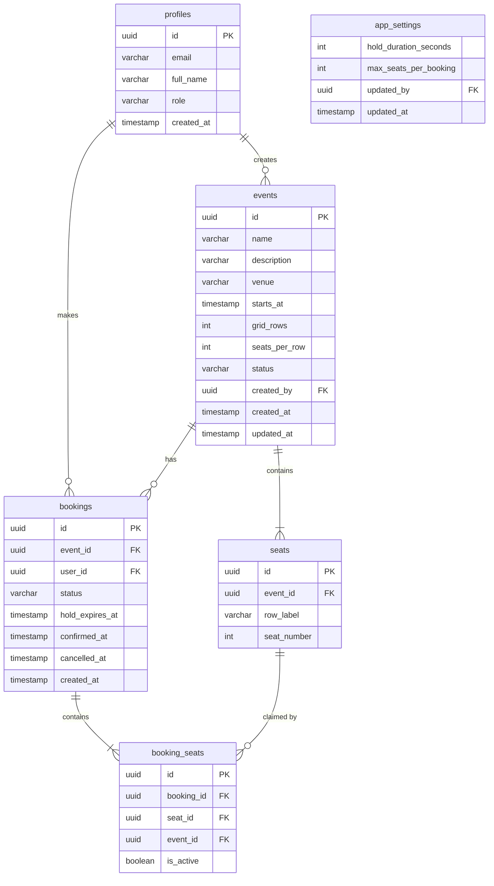

# Event Seat Booking Management System

## 1. Overview
A single‑page web application that lets **organizers** create events with a configurable seat grid and lets **attendees** browse events, select seats, place a temporary hold, and confirm a booking. The frontend is built with **React + Vite**, styled with **Tailwind CSS**, and communicates with **Supabase** (PostgreSQL + auth) through the `@supabase/supabase-js` client. All booking logic lives in **Supabase SECURITY DEFINER RPC functions**, guaranteeing that data integrity is enforced on the server side.

## 2. Problem Statement & Objectives
- **Problem:** Prevent double‑booking of seats while providing a smooth UI for seat selection, holding, and confirmation.  
- **Objectives:**  
  1. Store events, seats, and bookings in a relational database.  
  2. Offer a client‑side UI for seat selection.  
  3. Implement a *temporary hold* (default ≈ 5 min) that expires automatically (testing pending).  
  4. Enforce role‑based access (organizer vs attendee) via Supabase Row‑Level Security (RLS) and RPC checks.

## 3. Technologies Used
| Layer | Technology | Role |
|-------|------------|------|
| Front‑end | React, Vite, Tailwind CSS, Lucide icons | UI & routing |
| Data fetching | Custom hooks (`useAsyncData`) + `bookingService` wrapper | Async RPC calls |
| Backend | Supabase (PostgreSQL, auth, RLS, SECURITY DEFINER RPC) | Data storage & business logic |
| Client SDK | `@supabase/supabase-js` | Communicates with Supabase |
| Language | JavaScript (ES2022) / JSX | Source code |
| Package manager | npm | Dependency management |

## 4. Main Features (implemented)
| Feature | Description | Available to |
|---------|-------------|--------------|
| Event list | List of upcoming events (requires authentication) | Authenticated users |
| Seat map | Visual grid showing seat status (`available`, `taken`, `held`) (requires authentication) | Authenticated users |
| Hold seats | Selected seats are held for a short period (default ≈ 5 min) | Attendees |
| Confirm booking | Finalise a hold into a confirmed booking | Attendees |
| Cancel booking | Release a held or confirmed booking | Attendees |
| Create event | Define venue, grid size, description, hold duration | **Organizers only** |
| Cancel event | Cancel an entire event (all associated bookings are released) | Organizers only |
| View my bookings | List of bookings made by the signed‑in user | Attendees |

## 5. System Architecture
```mermaid
flowchart TD
    subgraph Frontend[React Frontend]
        FE[React components] --> BS[bookingService (RPC wrapper)]
    end
    subgraph Supabase[Supabase Platform]
        Auth[Auth (JWT)] --> RPC[SECURITY DEFINER RPC functions]
        RPC --> DB[PostgreSQL DB]
        DB --> RLS[Row‑Level Security policies]
    end
    FE -->|HTTPS| Auth
    FE -->|HTTPS| RPC
    RPC -->|SQL tables| DB
```
- The frontend authenticates via Supabase Auth, then calls RPC functions (`list_events`, `get_seat_map`, `hold_seats`, `confirm_booking`, …).  
- Each RPC runs inside its own PostgreSQL transaction, guaranteeing atomicity for that operation.

## 6. Database Schema (actual tables & columns)
| Table | Primary Key | Important columns |
|-------|-------------|-------------------|
| `profiles` | `id` (UUID, FK → `auth.users.id`) | `email`, `full_name`, `role` (`attendee` | `organizer`), `created_at` |
| `app_settings` | *(single‑row table, no explicit PK)* | `hold_duration_seconds`, `max_seats_per_booking`, `updated_by` (FK → `profiles.id`), `updated_at` |
| `events` | `id` (UUID) | `name`, `description`, `venue`, `starts_at`, `grid_rows`, `seats_per_row`, `status` (`active` | `cancelled`), `created_by` (FK → `profiles.id`), `created_at`, `updated_at` |
| `seats` | `id` (UUID) | `event_id` (FK → `events.id`), `row_label`, `seat_number` |
| `bookings` | `id` (UUID) | `event_id` (FK → `events.id`), `user_id` (FK → `profiles.id`), `status` (`held` | `confirmed` | `cancelled`), `hold_expires_at`, `confirmed_at`, `cancelled_at`, `created_at` |
| `booking_seats` | `id` (UUID) | `booking_id` (FK → `bookings.id`), `seat_id` (FK → `seats.id`), `event_id` (FK → `events.id`), `is_active` (boolean) |

### Migration stages (applied in this order)
1. **Schema migration** – creates the six tables listed above.  
2. **Security migration** – defines RLS policies and the `booking_seats_one_active_claim` partial unique index.  
3. **Booking RPC functions migration** – creates all SECURITY DEFINER stored procedures (`hold_seats`, `confirm_booking`, `cancel_booking`, `release_expired_holds`, …).  
4. **Event and seat seed data** – optional seed scripts that insert example events and generate seat rows.

## 7. Booking Workflow
1. **Seat selection** – UI loads the seat map via `bookingService.getSeatMap(eventId)`.  
2. **Hold request** – `bookingService.holdSeats(eventId, seatIds)` calls the `hold_seats` RPC.  
   - Checks that each requested seat is currently `available`.  
   - Creates a new row in `bookings` with `status = 'held'`.  
   - Inserts rows into `booking_seats` with `is_active = true`.  
   - Returns a summary containing `booking_id` and the calculated `hold_expires_at`.  
3. **Confirm** – `bookingService.confirmBooking(bookingId)` invokes `confirm_booking`, which updates the booking’s `status` to `confirmed` (provided the hold has not expired).  
4. **Cancel** – `bookingService.cancelBooking(bookingId)` calls `cancel_booking`, marking the booking and its `booking_seats` rows as inactive.  
5. **Expiration** – The RPC `release_expired_holds()` can be run manually to delete any holds whose `hold_expires_at` has passed. No scheduled Supabase cron job is configured.

## 8. Database Double‑Booking Protection
- **Partial unique index** `booking_seats_one_active_claim` on `booking_seats(seat_id)` with predicate `WHERE is_active`. This guarantees that only one active claim can exist for a given seat at any moment.  
- In the `hold_seats` RPC the relevant seat rows are locked with `SELECT … FOR UPDATE`, preventing race conditions when multiple users try to hold the same seat concurrently.  
- If a conflict is detected, the RPC raises an error with hint `SEATS_TAKEN`; the frontend catches the error, clears the selection, and reloads the seat map.

## 9. Authentication & Security
- Users authenticate via **Supabase Auth** (email & password). The JWT token is stored by the Supabase client.  
- Each authenticated user has a matching row in `profiles` where the `role` column records either `attendee` (default for new sign‑ups) or `organizer`.  
- The `organizer` role can only be assigned by an administrator (e.g., via a SQL `UPDATE profiles SET role = 'organizer' WHERE id = '<uid>'` executed in the Supabase dashboard or CLI). The README deliberately does **not** instruct modification of `auth.users`.  
- Row‑Level Security (RLS) policies use `profiles.role` and `auth.uid` to enforce:  
  - Only the **creator** of an event (`created_by`) may create, update, or cancel that event.  
  - Users may read events and seat maps **only after authentication**.  
  - Users may read/write only their own bookings.  
  - Direct `INSERT/UPDATE/Delete` on the core tables from the client is revoked; all mutations must go through the SECURITY DEFINER RPC functions, which also perform ownership checks.

## 10. Database ER Diagram


## 11. Installation & Setup
1. **Clone the repository**
   ```bash
   git clone <repo‑url>
   cd Event‑booking‑management
   ```
2. **Install frontend dependencies** (the `package.json` lives in `event‑booking‑frontend/project/`)  
   ```bash
   cd event-booking-frontend/project
   npm ci
   ```
3. **Create a Supabase project** (if you do not already have one).  
   - Enable **Email‑Password** authentication.  
   - Turn on **Row‑Level Security** for all tables.
4. **Deploy the database schema**  
   - Use the Supabase SQL editor or the Supabase CLI (`supabase db push`).  
   - Apply the migration **stages** in the order listed in section 6.  
   - Verify that the six tables and the `booking_seats_one_active_claim` index exist.
5. **Configure environment variables**  
   - Copy `.env.example` to `.env` inside `event‑booking‑frontend/project/`.  
   - Fill in the values from **Supabase → Project Settings → API**:
     ```text
     VITE_SUPABASE_URL=https://<project‑ref>.supabase.co
     VITE_SUPABASE_ANON_KEY=<public‑anon‑key>
     ```
6. **Run the development server**
   ```bash
   npm run dev
   ```
   Open `http://localhost:5173` in a browser.

## 12. Manual Test Cases (verified / pending)
| Test case | Status |
|-----------|--------|
| Sign‑up / login / logout | VERIFIED |
| Event loading (authenticated) | VERIFIED |
| Seat selection & hold | VERIFIED |
| Booking confirmation | VERIFIED |
| Booking cancellation | VERIFIED |
| Two‑user seat visibility | VERIFIED |
| Simultaneous same‑seat booking attempt | VERIFIED (only one succeeds) |
| Hold expiration (automatic release) | PENDING |
| Organizer event creation | NOT VERIFIED |

## 13. Limitations & Future Work
- No automated test suite (unit or end‑to‑end) is included.  
- Hold expiration is currently a manual RPC; adding a Supabase scheduled function would automate it.  
- The organizer UI is minimal; a richer dashboard could improve usability.  
- Real‑time seat updates are not implemented – the UI requires a manual refresh or re‑fetch after an error.  
- No payment integration is present.  
- Pagination of event or booking listings is not implemented.

---
*All information reflects the actual source code, database schema, RPC functions, and verified manual tests. No fictional features or configurations have been added.*